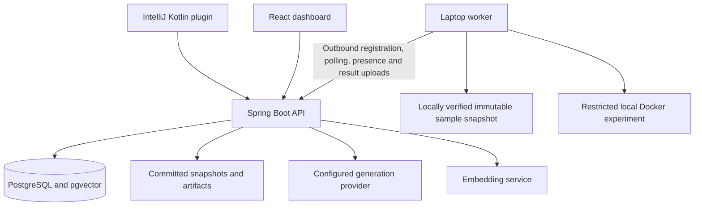

# BugTrace AI — final technical documentation

Documentation date: 2026-10-21. This describes the inspected local source, rather than a claim of production deployment. See source-manifest.json for exact source fingerprints.

## 1. Problem statement
Bug reports often lack reproducible steps, a precise source revision, or evidence connecting a proposed diagnosis to observed behavior. Developers must locate relevant code, reproduce the failure, assess proposed fixes and check regressions. An AI explanation alone does not establish correctness.Step 49 — Create the final documentation
Include:
- Problem statement
- Objectives
- Architecture
- Database design
- API specification
- Agent roles and tools
- Isolation policy
- Retrieval design
- Evaluation methodology
- Benchmark results
- Known limitations
- Setup guide
Explain what each technology contributes, including the DSA components.

## 2. Objectives
- Capture a bug report against a committed repository snapshot.
- Retrieve relevant source, relationships, documentation and saved execution evidence.
- Generate bounded reproduction proposals and execute approved trusted samples in isolated experiments.
- Preserve source hashes, execution results, diagnosis support and review decisions.
- Support project-scoped collaboration and IntelliJ submission/navigation.
- Compare a single-request baseline and the full workflow under a controlled evaluation protocol.

The final objective is an evaluation objective, not an established performance improvement.

## 3. Architecture

PostgreSQL holds durable job and investigation records. Snapshot and artifact files also need durable storage; database persistence alone does not preserve those files. The worker initiates connections. No inbound laptop worker access is required. Local Docker access remains on the laptop.

Typical flow: submit report → import committed snapshot → verify → retrieve evidence → generate test → inspect/approve execution → reserve budget and enqueue → worker verifies bindings → fresh experiment → upload logs/results → diagnose/propose patch → inspect verification → human review.

Queued, running, reproduced and verified are distinct states. A saved proposal or successful upload is not proof of a successful test.

## 4. Technology contributions
| Technology | Contribution |
|---|---|
| Java 21 / Spring Boot | Backend and worker services, validation, HTTP endpoints and scheduled polling |
| PostgreSQL | Transactional persistence, ownership, budgets, execution attempts and audit records |
| pgvector | Stored embeddings and semantic similarity retrieval |
| Flyway | Versioned schema changes V1–V25 in the inspected source |
| JPA/Hibernate and JDBC | Persistence mapping and explicit SQL for transactional operations |
| JavaParser | Java syntax and symbol/relationship extraction |
| Git | Exact committed revision capture and repository history context |
| SHA-256 | Content identity and tamper detection; hashes do not establish semantic correctness |
| React / TypeScript / Vite | Browser forms, investigation views and worker availability |
| Kotlin / IntelliJ Platform | IDE settings, submission action, context capture and navigation |
| Docker / Compose | Local infrastructure and constrained experiment containers |
| Maven / Gradle / npm | Dependency resolution, compilation, testing and packaging |
| GitHub Actions | Four ordinary CI jobs; explicit live-model workflow kept separate |
| Ollama embeddinggemma | Evidence embeddings in the configured local setup; not a generation model |
| Configured generation adapter | Structured reproduction/diagnosis/patch proposals; mock responses measure plumbing only |
| PowerShell | Local startup, authenticated worker launch and acceptance evidence collection |

Exact dependency versions are in the source build files and lockfiles recorded by the manifest. Do not substitute newer versions without validation.

## 5. Database design
See database-reference.md for the complete migration DDL.

| Domain | Main tables |
|---|---|
| Ownership and source | projects, repository_snapshots, investigations |
| Execution and evidence | executions, artifacts, evidence, execution_jobs, execution_job_attempts |
| Retrieval | java_symbol_indexes, java_relationship_graphs, semantic_indexes, semantic_chunks, context_indexes, context_chunks, context_embedding_cache |
| Model orchestration | ai_model_calls, agent_runs, agent_role_steps, role_tool_calls, investigation_loops and rounds/steps |
| Reproduction and diagnosis | reproduction_runs, reproduction_attempts, diagnosis_reports |
| Review | developer_patch_reviews, developer_patch_review_events |
| Benchmark | benchmark_case_registrations, benchmark_snapshot_imports, benchmark_reproduction_runs/steps, benchmark_source_versions, benchmark_case_records, benchmark_browser_requests, benchmark_execution_links |
| Team access | team_credentials, team_sessions, team_access_state, team_login_limits, team_audit_events |
| Availability | worker_presence |

Projects scope access. Investigations bind source snapshots; jobs and attempts represent dispatch and leased execution. Reviews retain proposal/evidence identity. Credentials bind worker project, snapshot and worker ID. Preserve foreign keys and uniqueness rules from the migrations rather than recreating an approximate schema.

## 6. API specification
See api-reference.md for controller mappings, request/response declarations and the permission inventory from the inspected version. It is a source-derived reference, not a generated OpenAPI guarantee. Controller declarations and service validators together define the accepted contract.

Use JSON requests. Human access uses the supported personal-key/session flows; worker credentials belong in authorization headers, never URLs. Browser mutations must follow the existing session/CSRF client. Ownership checks apply to investigations, logs, downloads and reviews.

Representative presence contract:
- POST /api/workers/presence: authenticated worker; contact binds workerId, snapshotId, contentHash, readiness and optional currentExecutionId.
- GET /api/workers/presence: authenticated human; server filters records to the actor's project.

Expected distinctions: 401 authentication missing/expired, 403 role or project denied, 409 conflicting/stale operation, and validation errors as specified by each controller. Do not treat a nonexistent record's 404 as proof of isolation. Download responses may be binary rather than JSON.

## 7. Agent roles and tools
These workflow roles differ from human permission roles.

| Server-selected agent role | Allowed tool names |
|---|---|
| EVIDENCE_ANALYST | searchCode, readFile, readEvidence |
| REPRODUCTION_AGENT | createTest, requestExperiment, readExecutionResults |
| DIAGNOSIS_AGENT | readEvidence, readExecutionResults, readTestReports |
| PATCH_AGENT | readDiagnosis, readRelevantFiles, proposePatch |
| VERIFICATION_AGENT | requestApprovedChecks, readTestReports, createVerificationSummary |

RoleToolPolicy limits tools and validates arguments/selected paths. A tool request still requires the appropriate server validation and execution approval. It does not authorize arbitrary shell access.

Human roles: Owner manages project access; Investigator submits/investigates; Reviewer reads and makes permitted review decisions; Viewer reads permitted project records. Worker is a separately bound machine credential. See the exact endpoint permission inventory.

## 8. Isolation policy
Demo execution is limited to registered approved public sample releases and permitted case modules. Bind registration, snapshot, content hash, generated-test path/class/source hash, environment and worker credential before dispatch and execution.

Each experiment uses fresh writable state derived from the verified immutable base. Preserve base checks before/after execution. Approved containers enforce the existing non-root, network, mount, resource and command restrictions. The hosted API must not supply arbitrary Docker flags, shell commands or laptop paths. Docker is a constrained execution mechanism, not a promise that arbitrary hostile repositories are safe.

Atomically reserve experiment/repair budgets and enforce remaining deadlines. Honor cancellation and lease fencing. Persist completed upload payloads before delivery; retry uploads without repeating execution. Acknowledged replay must match the original completion. Recovery of saved completed payloads does not imply recovery of every interrupted running container.

## 9. Retrieval design and DSA
Source indexes bind to snapshots. Lexical candidates, semantic chunks and document/history context supply bounded evidence channels. Java relationship information adds neighboring context. Citations retain file/line or execution identity.

HybridRanking uses reciprocal rank fusion: score(d) = sum(1 / (60 + rank_channel(d))). It avoids directly adding incomparable lexical and cosine scores. A stable candidate key deduplicates evidence; deterministic key ordering breaks score ties.

| DSA component | Implementation contribution and limits |
|---|---|
| Syntax trees | JavaParser structures declarations and relationships; syntactic evidence is not proof of runtime behavior |
| Graphs | Java relationship vertices/edges support bounded neighboring-source context; graph construction is not complete dynamic call analysis |
| Hash maps and sets | Candidate identity, rank lookup and within-channel deduplication; expected constant-time lookup, not a worst-case guarantee |
| Lists and sorting | Rank fusion accumulates candidate scores then sorts; for N unique candidates and M input entries, approximately O(M + N log N), plus retrieval/text costs |
| Durable queue and state machine | Database job/attempt states, leases and atomic transitions coordinate workers; this is not an in-memory FIFO guarantee |
| Bounded exponential backoff | Temporary connection retries use capped delays to reduce repeated requests |
| Content hashing | Linear work in bytes hashed detects modified snapshot/test content |
| Vector similarity | Matches related text using embeddings; do not claim a particular ANN algorithm unless enabled in the actual SQL/index configuration |

Retrieval is bounded and may omit relevant evidence. In the inspected service the result limit is 1–20 and lexical candidate truncation is reported. Do not claim complete repository understanding.

## 10. Evaluation methodology
Compare the single-request baseline with the full workflow using the same exact generation provider/model, public inputs and agreed budgets. Alternate execution order across repetitions. Use fresh investigation state without transferred conclusions or history.

For six cases and three repetitions per method: 36 investigations; four defect cases yield 12 defect investigations per method; two negative controls yield six control investigations per method. Repetitions are not distinct cases.

Freeze exact responses, tests, patches and hashes before private grading. Bind each evaluator invocation explicitly to the new response file and hash; scripts defaulting to earlier saved answers must be corrected. Preserve malformed/unsupported outputs as failures or incomplete results.

Use the same reproduction against original/proposed code, independent private checks, baseline-passing regression checks, diagnosis support and negative-control rules. Retain timeouts and infrastructure failures in attempted-run denominators. Optional executable-only rates must be separately labeled.

Report per-case and aggregate counts: valid reproduction / 12, verified patches / 12, appropriate abstention / 6 per method; supported answers / reviewed answers; regressions / comparable baseline-passing checks actually executed. Report duration/token/cost coverage and missing values. For each metric give Baseline, Full workflow, Difference, Missing or blocked runs.

## 11. Benchmark results and validation evidence
No frozen response/evaluator dataset was supplied for this documentation build. Accordingly reproduction rates, patch rates, abstention rates, regression rates and model comparisons are NOT REPORTED. Do not derive them from CI, mock investigations or a saved patch-review approval.

Observed hosted CI for Step 48: commit prefix 752a0a1, four successful jobs, duration 2m57s. Workflow: https://github.com/krishna-shetty29/bugtrace-ai/actions/runs/39577914586

Local Step 48 checks: user reports PASS; individual evidence paths must be preserved in the acceptance report. Remote HTTPS, hosted snapshot handling and hosted persistence remain pending; hosting has not begun. No claim of superiority over a baseline is supported here.

See benchmark-results.md for an explicit results ledger. Add actual measured results only with frozen inputs and evaluator evidence.

## 12. Known limitations
- Committed snapshots exclude staged, unstaged, untracked and unsaved modifications.
- Mock model outputs are workflow fixtures, not live-model performance evidence.
- Embeddings do not provide generation; select a backend-supported generation model separately.
- Presence BASE_VERIFIED confirms snapshot bytes, not Docker readiness. Queueing alone is not execution.
- Static source relationships and semantic similarity can be incomplete or misleading.
- Test failure needs classification: intended reproduction, invalid test, regression or infrastructure problem.
- Patch approval records a human decision; it does not apply, merge or deploy a patch.
- Completion outbox recovery requires preserved local files and consistent worker configuration; use one worker process per worker/snapshot identity.
- Local acceptance is not proof of cross-machine or hosted persistence.
- Required merge-check enforcement is limited by the current private-repository plan.
- Hosting providers and current free-tier eligibility are not selected; zero hosting fees are unverified.

## 13. Setup guide
See setup-guide.md and the included local-startup.md/continuous-integration.md for commands and prerequisites. Preserve the existing .env and database volume. Keep credentials in private storage, and keep local backup/outbox/evidence folders out of Git.

## 14. Documentation acceptance
See acceptance-results-template.txt. Review source-derived contracts, run setup on the intended machine, insert measured benchmark evidence if available, and record any pending sections. Documentation can be complete while clearly stating that deployment and controlled performance evaluation are pending.
